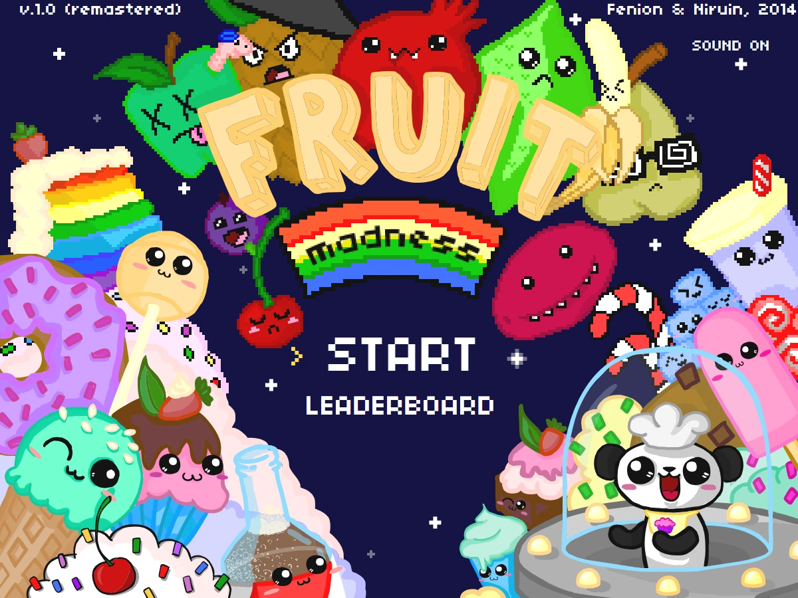

# Fruit Madness Remastered

Fruit Madness is an endless arcade dodge-'em-up. A panda in a UFO, an endless swarm of very angry fruit, and one muffin between you and an empty tank. You fly a small flying saucer across a 600×450 pixel starfield while waves of fruit charge in from every side, and your only job is to slip through the gaps and keep collecting the muffins that refuel you. Every attack flies a single fruit (cherry, apple, pear, pomegranate, lime or banana), and the DANGER sign that announces the next one always means a different face is coming. Pixel art, chiptune and a fixed 60 Hz step, in the spirit of NES-era arcade games. It runs in any modern browser with no install and no plugins at https://leinstay.github.io/fruit-madness-remastered/.

The original Fruit Madness was a Flash game we made in 2013 ([leinstay/fruitmadness](https://github.com/leinstay/fruitmadness), ActionScript 3). Flash is gone, so this is a from-scratch HTML5 remaster with the same physics constants, the same artwork and the same music, rewritten in plain JavaScript with no plugin, no build step and no dependencies. The playfield is drawn from the original vector artwork at the real resolution of your display, and every caption is set in the game's own pixel font, so the game stays sharp in any window.



## Features

* The tank holds 100 units of fuel and drains by 0.05 per frame, which is about 33 seconds of flight. Every muffin gives back 10. Run dry and the saucer does not die, it crawls. Top speed drops from 6 to 0.5 px per frame and you are a sitting duck.
* Every muffin lights one of the four cells of the combo bar, and every lit cell raises the score multiplier (up to ×5). A muffin is worth 100 points times the multiplier it has just raised, so 200 for the first one and 500 on a full bar. The bar does not last. Cells burn down one at a time from the right, four seconds each, so keep the muffins coming. Missing one costs you nothing but the fuel.

## Controls

| Action | Keyboard | Touch |
|---|---|---|
| Move | `W` `A` `S` `D` or the arrow keys | touch anywhere on the field, a floating joystick appears under your thumb |
| Pause | `P` or `Esc` | the on-screen `PAUSE` button |

## Running

```bash
git clone https://github.com/leinstay/fruit-madness-remastered.git
cd fruit-madness-remastered
python -m http.server 8080
```

Then open http://localhost:8080. A server is required because the game is made of ES modules, which browsers refuse to load over `file://`.

## Tests

```bash
node --test tests/          # 272 tests, about a minute
```

The long survivability proof is opt-in because it is slow:

```bash
SOLVER_SEEDS=100 SOLVER_FRAMES=3600 node --test tests/solvability.test.js
```

`SOLVER_SEEDS` is how many worlds to check (12 by default) and `SOLVER_FRAMES` how many frames of each (3600 is one minute of play).

## Layout

```
index.html          the page, a canvas and the nickname field
css/                the page shell and the mobile layout
js/
  main.js           entry point and scene switching
  config.js         constants of the original, tuned in 2013
  core/             loop, input, audio, asset loading, seeded rng, sprite animation
  game/             player, enemies, formations, director, collisions, combo (pure logic)
  scenes/           menu, game, game over, leaderboard
  services/         the Firestore leaderboard client
assets/             the vector artwork, the pixel font, music and sound effects
tests/              node --test suites, including the survivability simulator
tools/              make-svg-sprites.mjs prepares the gameplay drawings, make-title.py
                    builds the title screen, and xfl2svg.py converts drawings from the
                    original 2013 Flash source document to SVG
firestore.rules     the leaderboard security rules
```

## License and credits

MIT License, see [LICENSE](LICENSE). Artwork, music and the pixel font come from the original 2013 game, [leinstay/fruitmadness](https://github.com/leinstay/fruitmadness).
